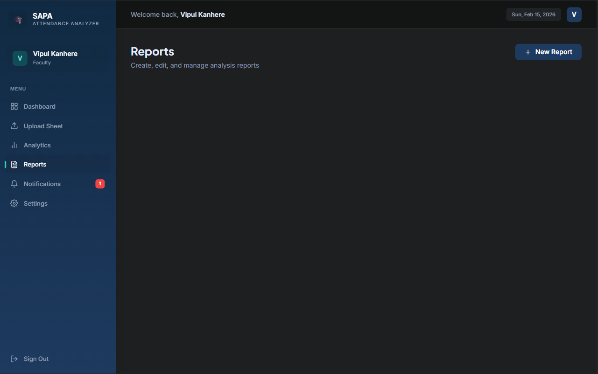

<div align="center">

# 🎓 SAPA — Smart Attendance Pattern Analyzer

### *Transforming raw attendance data into actionable academic insights*

[](https://choosealicense.com/licenses/mit/)
[](https://nodejs.org/)
[](https://reactjs.org/)
[](https://www.mongodb.com/)
[](https://tailwindcss.com/)

<br/>

[**Live Demo**](https://your-demo-link.com) · [**Report Bug**](https://github.com/YOUR_USERNAME/SAPA-Smart-Attendance-Pattern-Analyzer/issues) · [**Request Feature**](https://github.com/YOUR_USERNAME/SAPA-Smart-Attendance-Pattern-Analyzer/issues)

<br/>

<!-- Replace this with your actual screenshot -->


</div>

---

## 📌 Problem Statement

Educational institutions struggle with **manual attendance tracking**, leading to
inaccurate records, delayed interventions for at-risk students, and zero
predictive capability. Faculty spend hours on spreadsheets instead of teaching.

## 💡 Solution

**SAPA** automates attendance analysis by ingesting spreadsheet data, detecting
patterns using statistical algorithms, and presenting insights through an
intuitive dashboard. It predicts students at risk of falling below attendance
thresholds and sends automated notifications — **before** it's too late.

---

## ✨ Key Features

<table>
<tr>
<td width="50%">

### 📊 Intelligent Dashboard
Real-time attendance statistics with interactive charts,
trend lines, and comparative analytics across sections
and subjects.

### 📁 Bulk Upload
Drag-and-drop Excel/CSV upload with automatic parsing,
validation, and duplicate detection.

### 🔮 Predictive Analytics
Pattern recognition algorithms identify students likely
to breach minimum attendance requirements.

</td>
<td width="50%">

### 🔔 Smart Notifications
Automated email/in-app alerts for students approaching
attendance thresholds (75%, 65%, etc.).

### 👥 Role-Based Access
Separate interfaces for Students, Faculty, and
Administrators with granular permission control.

### 📋 Report Generation
One-click downloadable reports in PDF/Excel format for
departmental records and audits.

</td>
</tr>
</table>

---

## 🛠️ Tech Stack

| Layer        | Technology                                        |
|:-------------|:--------------------------------------------------|
| **Frontend** | React 18, Vite, Tailwind CSS, Chart.js / Recharts |
| **Backend**  | Node.js, Express.js, REST API                     |
| **Database** | MongoDB Atlas with Mongoose ODM                   |
| **Auth**     | JWT + OTP-based email verification                |
| **Tooling**  | ESLint, Prettier, Git, GitHub Actions             |

---

## 📸 Screenshots

<div align="center">
<table>
<tr>
<td></td>
<td></td>
</tr>
<tr>
<td align="center"><b>Secure Login with OTP</b></td>
<td align="center"><b>Analytics Dashboard</b></td>
</tr>
<tr>
<td></td>
<td></td>
</tr>
<tr>
<td align="center"><b>Bulk Sheet Upload</b></td>
<td align="center"><b>Generated Reports</b></td>
</tr>
</table>
</div>

---

## 🚀 Getting Started

### Prerequisites

- **Node.js** ≥ 18.x — [Download](https://nodejs.org/)
- **MongoDB** Atlas account — [Sign up free](https://www.mongodb.com/atlas)
- **Git** — [Download](https://git-scm.com/)

### Installation

1. **Clone the repository**

   ```bash
   git clone https://github.com/YOUR_USERNAME/SAPA-Smart-Attendance-Pattern-Analyzer.git
   cd SAPA-Smart-Attendance-Pattern-Analyzer

2. **Set up the backend** 

cd server
npm install
cp .env.example .env
# Open .env and fill in your MongoDB URI, JWT secret, and email credentials

3. **Set up the frontend**

cd ../client
npm install

4. **Run the application**

# Terminal 1 — Start backend
cd server
npm run dev

# Terminal 2 — Start frontend
cd client
npm run dev

5. **Open your browser at http://localhost:5173**

### Project Architecture

smart-attendance-analyzer/
├── server/                  # Express.js REST API
│   ├── config/              # Database configuration
│   ├── controllers/         # Request handlers
│   ├── middleware/           # Auth & validation middleware
│   ├── models/              # Mongoose schemas
│   ├── routes/              # API route definitions
│   ├── utils/               # OTP service & analytics engine
│   └── server.js            # Entry point
│
├── client/                  # React + Vite SPA
│   ├── src/
│   │   ├── components/      # Feature-based components
│   │   ├── context/         # Global state (AuthContext)
│   │   ├── utils/           # Axios API configuration
│   │   ├── App.jsx          # Route definitions
│   │   └── main.jsx         # React DOM entry
│   └── index.html
│
├── docs/                    # Screenshots & documentation
├── .gitignore
├── LICENSE
└── README.md

### Future Enhancements

*  Face-recognition based attendance marking
*  Mobile app (React Native)
*  Integration with university ERP systems
*  Advanced ML models for dropout prediction
*  Multi-language support (i18n)

### Contributing
Contributions make the open-source community amazing. Any contributions are
greatly appreciated.

1. Fork the Project
2. Create your Feature Branch (git checkout -b feature/AmazingFeature)
3. Commit your Changes (git commit -m 'Add some AmazingFeature')
4. Push to the Branch (git push origin feature/AmazingFeature)
5. Open a Pull Request

### License
Distributed under the MIT License. See LICENSE for more information.

### Author
Vipul Kanhere

* GitHub: @V1PU1LXRD
* LinkedIn: https://www.linkedin.com/in/vipul-kanhere-903b8033a/
* Email: vipul.kanhere@gmail.com

<div align="center">
⭐ If this project helped you, consider giving it a star! ⭐
</div>
```